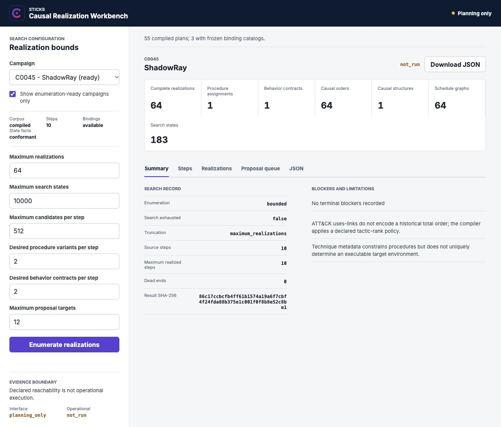

# STICKS Reproducibility Artifact

STICKS is a finite-domain procedural-admission artifact. It compiles pinned
ATT&CK campaign structure into typed plans, enumerates candidates from a
versioned template catalog, checks them against an explicitly scoped state,
and records what the CTI, environment, and reconstruction each contribute.

## Start here: one command per question

Start with `bash run.sh review` to reproduce the released results without a model API or virtual machines.
Use `bash` for both Git clones and downloaded ZIPs; the anonymous ZIP does not preserve executable permissions.

Everything a reviewer runs goes through `bash run.sh`. No service is started by
hand; the Python environment is created and installed on first use.

```bash
bash run.sh            # lists the commands, what each establishes, its time and needs
bash run.sh demo       # 1 s: one archived step across three arms
bash run.sh review     # ~4 min after the first install, offline: regenerates every record,
                    # checks every claim, runs the tests
bash run.sh doctor     # read-only laboratory check that prints the exact fix for any failure
bash run.sh lab        # 5-60 min per cycle, network-bound: brings up CALDERA,
                    # attacker and target VMs, runs C0026, observes the target independently,
                    # destroys the VMs, seals and verifies the receipt
bash run.sh all        # all of the above
```

The laboratory was validated on Apple-silicon macOS (QEMU, `vagrant-qemu`,
`socket_vmnet`). Its guests use the public ARM64 box `perk/ubuntu-2204-arm64`,
which Vagrant downloads on the first run; provisioning needs network access.
Package, CALDERA and plugin downloads can dominate provisioning even with a cached base box; each fresh VM downloads them again, so one C0026 cycle took 4.5 minutes on a fast link and 57 minutes on a slow one on the same host.
On other hosts `bash run.sh doctor` says so before anything starts.

`bash run.sh lab --campaign 0.c0010` or `--campaign 0.costaricto` runs the other
campaigns with a typed laboratory contract. Evidence goes to
`~/sticks-runs/<campaign>-<UTC time>` unless `--run-root` names another new directory.

During provisioning, campaign execution or typed target observation, a first
Ctrl+C (`SIGINT`) or `SIGTERM` attempts teardown of the lab created by that run and restores the
saved workspace state. The command still exits unsuccessfully; execution and
cleanup errors are both reported when both fail. A lab supplied through
`--assume-lab-running` is preserved unless teardown was explicitly requested.
`--keep-lab` retains a successful run for observation, not an interrupted run.
Stop-signal tests use disposable process fixtures with infrastructure commands
stubbed; they do not measure VM-provider teardown under a real interruption.
Forced termination (`SIGKILL`) cannot run Python cleanup. Keep the failed run directory for diagnosis and use a new
run root for a retry.

The isolated supervisor forwards `SIGINT` and `SIGTERM` to the child process
session it created and continues draining its execution log while the child
handles the stop. A stop request makes the supervisor exit unsuccessfully even
if the child returns zero. Other process sessions are not signaled.

Use Ctrl+C once to request a graceful stop from the laboratory command. It waits
for the active stage and scoped completion before returning a nonzero status.
Further stop requests leave that cleanup running. If run metadata is incomplete,
the command retains the workspace and reports that cleanup is unconfirmed;
inspect that state before retrying. Stop tests cover disposable process fixtures,
not interrupted QEMU-provider teardown.
The sections below explain each path and what it does not establish.

## Repository structure

`src/` contains contracts and execution logic, `data/` the pinned inputs,
`release/` the experiment ledger, `docs/` operator guides, and `tests/` checks.

## Evaluation qualities

The reviewer gate checks integrity, regenerated evidence, claims and tests.
Availability additionally depends on the public distribution endpoint.

## Basic information

The offline gate needs a POSIX shell, Python 3.11 or newer, Git, curl and shasum; it needs no GPU,
model API, or hypervisor. Allow 4 GiB RAM and 1 GiB free disk for that gate.
VM-backed experiments require additional resources and prepared images.
On Debian/Ubuntu, install the shell tools with `sudo apt-get install git curl libdigest-sha-perl`. Run `bash run.sh doctor review` to check the offline prerequisites. The review command runs this preflight before recomputing results.

## Dependencies

`requirements.txt` installs the exact versions in `requirements.lock`.
`bash run.sh` creates `.venv` and installs them on first use. An interpreter named
through `STICKS_PYTHON` is used as is and must already have them.

## Security considerations

The primary gate performs local computation and a benign loopback transfer.
Run VM-backed emulation only in an isolated disposable laboratory. The platform
requirements and limits are in `docs/IAC_LIMITATIONS_ARM64.md`.

## See the result first

```bash
python3 scripts/demo.py
```

Runs in under a second with no dependencies, no network, and no model. It reads an archived
proposal study and shows one campaign step across three arms: without deterministic admission,
a proposer emits a step rejected by the contract checker; the admitted arm abstains. The totals
describe that historical diagnostic. They are neither observed target effects nor current
manuscript results.

## Run the method on a campaign you choose

```bash
python3 scripts/emulate.py C0045                       # a campaign the catalog covers
python3 scripts/emulate.py C0001                       # one it does not
python3 scripts/emulate.py C0045 --bundle your.json    # your own STIX bundle
python3 scripts/emulate.py C0045 --config your.json    # your own model proposes
```

This is the method, not a recording. It compiles the campaign from a STIX bundle, derives the
minimal laboratory the plan can bind against from the catalog rather than asking you to author one,
and concretizes each step under deterministic admission. Steps with no admissible realization are
reported as such, never filled in: on C0045 it admits 10 of 10 steps, and on C0001 it admits 1 of 27
and names the 26 it will not commit.

Without `--config` the run is offline and deterministic, with the finite-domain solver proposing.
With `--config` your own model proposes through a provider configuration (see `config.example.json`,
which reads the key from an environment variable) and the same verifier decides, so substituting a
model never changes what admission means.

## Inspect admission in the workbench

After [installation](#installation), start the local interface:

```bash
bash run.sh workbench
```

Open `http://127.0.0.1:8765/`, select C0045 (ShadowRay), and click
**Enumerate realizations**. The summary shows the search bounds, realized steps
and result digest. **Steps** exposes per-step candidates; **Download JSON**
exports the inputs, result and proposal queue for inspection. **Causal graph**
draws the selected realization as a DAG, from the initial state through each
step to the goal; selecting a step lists the facts it consumes and enables.



This capture uses the default ceiling of 64 realizations. The interface reports one procedure assignment and one causal structure;
the 64 returned realizations differ in causal order. The search stopped at
that ceiling, so `search_exhausted: false` means additional orders may remain.
The operational status is `not_run`; this screen records a planning computation.
For a fresh VM-backed execution and its target observations, follow the
[reviewer quickstart](docs/reviewer_quickstart.md#optional-vm-backed-laboratory).
Stop the interface with Ctrl-C.

### Admit a campaign from your own STIX bundle

The panel **Admit a campaign from your STIX bundle**, below the search bounds,
runs the same service as `scripts/emulate.py --bundle`: it compiles the campaign
from the bundle you choose (up to 128 MiB), derives the lab from the template
catalog and admits each step offline. The result lists admitted and unresolved
steps, the causal certificate and the bundle's SHA-256; **Download JSON** saves
it. Nothing is executed and the server accepts requests only from its own page.
The same JSON comes from the command line:

```bash
review_outputs="$(mktemp -d "${TMPDIR:-/tmp}/sticks-review.XXXXXX")"
bash run.sh emulate C0045 --bundle "$HOME/Downloads/your-bundle.json" \
  --json-output "$review_outputs/C0045.admission.json"
```

The two outputs are identical for the same bundle and campaign. Unknown
campaigns, files that are not STIX 2 bundles and invalid identifiers are
rejected with an explanation; the CLI then exits with status 2.
Replace the bundle path with its actual location. Keep user-supplied bundles and
exports outside the immutable artifact directory so later integrity checks pass.

### Recompute the exported planning result

After downloading `C0045.realization-space.json`, recompute and compare the full
workbench object through the same application service:

```bash
review_outputs="$(mktemp -d "${TMPDIR:-/tmp}/sticks-review.XXXXXX")"
bash run.sh workbench \
  --from-result "$HOME/Downloads/C0045.realization-space.json" \
  --output "$review_outputs/C0045.recomputed.json"
```

Adjust the Downloads path if your browser saves elsewhere. The new temporary
directory keeps results outside the artifact and avoids overwriting an earlier
export. The command reloads the campaign's bundled plan, bindings and templates and uses
the bounds recorded in the export. It compares the recomputed object with the
supplied object before writing a new output. Changed inputs, modified results or
an unavailable campaign produce a nonzero exit; existing output files are not
overwritten. The GUI displays the command for the campaign actually selected.

To request a different bounded enumeration, pass a JSON object conforming to
`WorkbenchEnumerationRequest` with `--request request.json --output new-result.json`.
This uses the same service and validates its limits. Both modes compute planning
results with `operational_status: not_run`; the laboratory workflow is separate.

## Use your own model

The proposer runs on any provider. To use your own OpenAI key, copy the example and export the key
the config names:

```bash
export OPENAI_API_KEY=sk-...            # your key; never commit it
python3 scripts/emulate.py C0045 --config config.openai.example.json
```

The config carries only the environment-variable name, never a key. Without a config the run uses
the offline solver, so the artifact reproduces with no key and no cost.

## Installation

The exact dependency lock records the Python 3.11 reference environment. The
extracted reviewer package has also passed its complete claim, test, and
integrity gate under Python 3.13. Keep the lock pins when using a newer
interpreter so the interpreter change is the only variable.

```bash
python3 -m venv .venv
.venv/bin/python -m pip install -r requirements.txt
bash run_review_check.sh
```

After dependency installation, this command is offline. It regenerates the
evidence, validates SHA-256 hashes, audits claim chains, checks the public
surface, and runs the tests. It needs no Docker, VM, API key, or paid model.

### Optional QA dependencies

To exercise mocked legacy HTTP paths without changing the primary environment:

```bash
python3 -m venv .venv-qa
.venv-qa/bin/python -m pip install -r requirements-qa.txt
.venv-qa/bin/python -m pip check
.venv-qa/bin/python -m pytest tests/test_legacy_infrastructure_paths.py -q -p no:cacheprovider
```

The exact optional profile extends the primary lock. Provider calls are mocked;
passing these tests is not VM campaign qualification. Installation needs access
to a package index; the tests themselves do not.

`tests/test_qemu_network_serialization.py` additionally requires Ruby with YAML.
The JavaScript state test in `tests/test_workbench_browser_state.py` requires
Node.js on PATH. They explicitly skip when those interpreters are absent.
Tests requiring real lab-run evidence can still skip if that evidence is absent.
Report skips separately rather than treating missing execution as success.

For the complete reviewer wrapper, select an existing environment explicitly:

```bash
STICKS_PYTHON="$PWD/.venv-qa/bin/python" bash run_review_check.sh
```

`STICKS_PYTHON` takes precedence over the repository `.venv` and PATH. It must
name an executable interpreter with the required dependencies. An invalid
selection fails without installation or fallback. Without this
override, the wrapper retains its repository `.venv`, then PATH selection.
Install the selected dependency profile first; selection checks core imports,
not exact dependency versions.

Expected headline output includes 55 campaigns and 1146 steps in the corpus,
252 catalog-supported steps, which is 252 of 1146 corpus steps (22.0%), 0/25
admitted steps from the unaugmented representation versus 25/25 reconstructed
steps in the deep slice, 54 binding occurrences, and 79 explicit execution
commitments.

## Review and live execution paths, deliberately separated

The supported paths answer different questions and must not be substituted for one another.

| Mode | Command | What it establishes | What it never establishes |
| --- | --- | --- | --- |
| Fast review | `bash run_review_check.sh` | Offline integrity, regenerated evidence, claim-ledger consistency, and tests from the supplied package. | A live VM, a SUT effect, or a campaign replay. |
| Preflight | `python3 scripts/doctor.py --path lab` (or `--path docker --compose FILE`) | Read-only host readiness, with the exact fix printed for each failing check. Nothing is started or deleted. | Any experimental result. |
| Typed laboratory | `bash artifact/run.sh --run-root /absolute/new/run [--campaign 0.c0026\|0.c0010\|0.costaricto]` | One command: preflight, a fresh QEMU cycle, independent target observation, teardown, a sealed receipt and its verification (plus the CALDERA journal check where CALDERA dispatches). `artifact/validate.sh` re-verifies a completed run later. | Historical replay, an all-observed campaign, or support for arbitrary campaigns. |
| Strict experiment | `PYTHONPATH=src python3 scripts/run_strict_c0045_effect_series.py --output-dir /absolute/empty/output` | A fresh-boot C0045 target-effect study with every selected cell retained and each failure terminal. | A complete Caldera campaign, cross-SUT generalization, or a claim outside the frozen C0045 ceiling. |

The Compose files under `lab/docker/` and `measurement/sut/` are earlier
environments kept because frozen records hash them. No claim in
`release/claims/ledger.json` depends on starting them, and `bash run.sh` never does.

The laboratory entry point dispatches target commands through a fresh Caldera agent and retains the native command journal. Vagrant/SSH provisions the laboratory and runs independent target observations. This single-target path does not establish an attacker pivot through an enterprise network. It uses C0026: five observed effects and one explicitly simulated occurrence in the qualified run. It refuses legacy campaigns without typed runtime contracts before provisioning. The former `0.c0011` example can create local or simulated artifacts and is not a live SUT acceptance path. An available VM alone never authorizes that interpretation.

### Prospective C0026 dispatch through CALDERA

The development runner also supports a prepared CALDERA agent on the declared
Linux target. This path enrolls a new agent after provisioning, binds the session
to the target boot, and retains each command's intent, native link and verified
result. Independent target probes retain their separate transport.

```bash
python scripts/run_isolated_lab_campaign.py --campaign 0.c0026 --provider qemu \
  --run-root /absolute/new/run --caldera-dispatch --keep-lab
python scripts/complete_c0026_run.py --run-root /absolute/new/run
python scripts/finalize_isolated_lab_run.py --run-root /absolute/new/run --verify
python scripts/verify_caldera_run_journal.py --evidence /absolute/new/run/evidence
```

Completion observes the target before destroying the guests and seals the final
receipt. Always run completion for the retained run, including after a failed
campaign: it attempts teardown and propagates the failure. A malformed journal
prevents certification. The native command and the independently observed effect
are distinct records. This path covers the controlled C0026 slice, including its
explicit simulation; it does not establish an enterprise multi-host pivot.

Strict mode is QEMU-only. The v1 preflight proved host readiness but did not
bind guest downloads performed during provisioning. It is therefore retired,
not relabeled. The current v29 profile binds an offline,
prepared runtime manifest (guest inventory plus image fingerprint) for each
role -- Caldera, attacker, and target -- and every provisioning input before
the first VM can start. The preflight independently compares each installed
role image with that manifest. It also binds the transitive closure of the
Python modules and shell entry points that execute the cell; packaging-only
tools are intentionally outside that closure. A stale or missing input is an
error; there is no fallback provider, implicit install, or reuse of a prior
boot. The earlier preflight receipt is a diagnostic host record, never a
scientific outcome.

For an operator who wants to inspect prerequisites without executing a cell:

```bash
python scripts/preflight_strict_c0045.py --output-dir /absolute/empty/output
```

The v29 preflight binds the version-9 manifest, including the rebuilt
`sticks/caldera-python-65452f298d96-arm64` CALDERA box and the retained attacker
and target images, in the `libvirt` format required by the QEMU plugin. A
different image, stale input, missing socket, duplicate network daemon, or runtime-source
drift fails closed; it must not be worked around with a networked guest
bootstrap or a rewritten historical hash.

The previously frozen 20-cell series retains its original runtime profile,
20 distinct boots, and 20 teardowns. Its reviewed portable evidence is bundled
with the public release. The v29 runtime refresh was separately qualified on
one treatment cell; it does not replace that scientific series. Prepared box
archives remain local. See `docs/caldera_runtime.md` for rebuild and qualification
requirements before running on another host.

The output directory is part of the evidence boundary. Keep it outside the
repository, preserve every retained failure, and archive only after the archive
verifier and the semantic privacy review both pass. The preflight receipt proves
host readiness, not a scientific outcome.

## Evidence map

- `release/claims/ledger.json`: registered and blocked properties.
- `release/claims/evidence_sha256.json`: pinned integrity manifest.
- `release/experiments/`: generated experiment records and tables.
- `release/plans/`: typed plans, catalogs, and concretized plans.
- `release/paper_macros.tex`: generated manuscript values.
- `tests/`: checks linked from the ledger.

## Multiple causal realizations

The default compiler selects one deterministic realization. The opt-in realization-space
compiler enumerates a bounded family of admitted procedure assignments and causal orders:

```bash
python scripts/enumerate_realization_space.py \
  --plan release/plans/C0010.procedural-plan.json \
  --bindings release/plans/C0010.binding-catalog.json \
  --output /tmp/C0010.realization-space.json \
  --require-realization
```

The output separates raw candidates, procedures that participate in complete graphs, and
ordering variants. It also records explicit search limits and `operational_status: not_run`.
See `docs/REALIZATION_SPACE.md` for guarantees and non-claims.

The local workbench exposes the same enumerator over the pinned campaign inventory:

```bash
python scripts/run_realization_workbench.py
```

Open `http://127.0.0.1:8765`. The interface lists the complete corpus, fails closed when a binding
catalog is absent, measures procedure-assignment and behavior-contract deficits separately, and
produces a bounded campaign-and-SUT-aware proposal queue. It does not call a provider or execute a
campaign. The D1/D2/D3 design decision and finite-state model are specified in
`docs/RECONSTRUCTION_ARCHITECTURE.md`.

The following static audit covers every indexed campaign without calling a provider or executing a
campaign. It distinguishes absent pinned inputs from bounded planning readiness:

```bash
python scripts/audit_stage2_curation_readiness.py \
  --output /tmp/stage2-curation-readiness.json
```

`scripts/run_stage2_curation.py` composes the bounded proposal path into a hash-bound planning
ledger. It accepts only a budgeted provider configuration and abstract template metadata; a
candidate remains `planning_only` unless a pre-existing hash-bound laboratory implementation
witness is supplied. Its output remains `not_run`.

The finite-state fact vocabulary has a separate versioned identity-and-origin audit:

```bash
python scripts/audit_fact_semantics.py --output /tmp/fact-semantics-audit.json
```

It checks that a fact used as a SUT initial state, goal, precondition, or effect has a unique
semantic identity and an allowed origin. It is a static modeling control, not evidence that a
state held during a live run. See `docs/FACT_SEMANTICS.md`.

`CONTROLLED_COMPARISON.md` documents matched-arm, blinded executability check, run-accounting, and
revision-bound handoff contracts for a future comparative experiment. Those contracts are tested
infrastructure, not a completed baseline result and not evidence for a registered property.

When a manuscript source is colocated with the artifact, audit it too:

```bash
PAPER_DIR=../paper bash run_review_check.sh
```

## Interpretation boundary

The corpus coverage reported above is distinct from the deep evaluation, which
covers three fully supported campaigns and demonstrates the admission
mechanism, not corpus-wide replay coverage. The artifact does not claim
historical reconstruction, full campaign replay, observational equivalence,
or analyst-effort reduction.

Positive-evidence technique-set identifiability is not procedural reconstruction. A small
distinguishing witness can identify a corpus label without supplying order, bindings,
preconditions, or an executable procedure.

## Secondary legacy experiments

Earlier container, VM, and SUT experiments remain available for inspection and
compatibility. They are outside the primary claim ledger:

```bash
bash run_review_check.sh --legacy
```

A green legacy check does not support a property absent from the ledger.

For two sealed QEMU runs created from the same source tree, retain both run
directories and audit their typed outcomes with:

```bash
PYTHONPATH=src:. python3 -m scripts.audit_typed_campaign_outcomes \
  --run-root /path/to/C0010-run --run-root /path/to/C0026-run
```

The auditor recomputes each final receipt and reports observed effects on the
target and controller separately from simulations and failures. It rejects
different source trees. The offline package contains no QEMU run directories;
this command validates new or separately supplied runs. Passing the offline
review check alone does not establish VM-backed campaign execution.


## Minimal test

```bash
.venv/bin/python -m pytest tests/test_realization_space.py -q -p no:cacheprovider
```

## Experiments

Use the reviewer gate above for frozen evidence and `scripts/emulate.py` for a
new admission computation. `docs/reviewer_quickstart.md` describes the workbench.
To verify a separately supplied typed archive without starting VMs:

```bash
PYTHONPATH=src:. python3 -m scripts.verify_typed_evidence_archive \
  --archive /path/to/typed-qemu-evidence.tar.gz
```

The default offline package contains no live QEMU run directories. Bundled
archives preserve selected records; their verification is distinct from a new run.

## License

See `LICENSE` for this software and `THIRD_PARTY_NOTICES.md` for bundled inputs.
