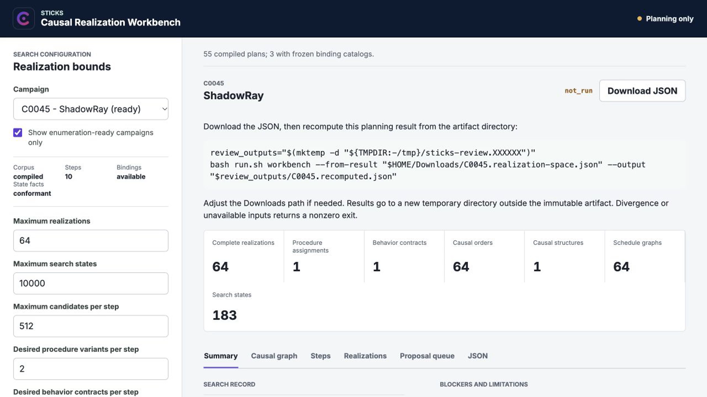

# Reconstruct, inspect and audit campaign planning

[Watch the recorded walkthrough](tutorial.mp4) (5m36s), with [English captions](english.vtt),
[transcript](transcript.txt), [chapter times](chapters.json) and
[execution evidence](execution-evidence.json).



Use this workflow to inspect which concrete procedures the declared catalog and
environment admit, identify unresolved steps, and audit the complete result by CLI.
The recording contains actual tool output. Planning does not execute campaign actions.

## Start from the anonymous artifact

Extract the ZIP linked in the paper. In its root directory, run:

```sh
bash run.sh workbench
```

Python 3.11 or newer is required. The first launch installs pinned dependencies
and therefore needs network access. Open the local address printed by the launcher
(normally `http://127.0.0.1:8765`). No model key or VM is needed for these tasks.
If that port is occupied, use `bash run.sh workbench --port 8766`.

## Inspect the supplied campaign

Select **C0045 — ShadowRay**, retain the default bounds and click
**Enumerate realizations**. The result contains 64 schedules, one procedure
assignment, one behavior contract and one causal structure. These are different
orders permitted by the declared dependencies, rather than 64 independent behaviors.
`search_exhausted: false` records the enumeration ceiling; `not_run` records the
operational boundary.

Use **Steps** for technique coverage and candidate participation. In **Realizations**,
inspect templates, assumptions and the composition's fidelity ceiling. The
**Causal graph** exposes declared fact dependencies; selecting a node shows its
required and produced facts. A step's fidelity label and the whole composition's
fidelity ceiling describe different objects. Scroll sideways when the graph extends
beyond its panel. The **Proposal queue** prepares deficits and targets; opening it
does not call a model or admit new templates.

Download the JSON. Copy the recomputation command shown by the interface, adjusting
the download path if needed. It uses a new temporary output directory outside the
immutable artifact. The CLI compares the complete workbench object, including its
inputs and bounds; divergence returns a nonzero exit. Keep the downloaded and
recomputed JSON with the artifact version.

Change **Maximum realizations** to 8: the earlier result and download disappear.
Enumerate again and inspect the new eight-schedule result. Export the new result
separately if you want to retain both bounds.

## Admit a campaign from your bundle

In **Admit a campaign from your STIX bundle**, enter the campaign identifier,
choose a JSON bundle (up to 128 MiB), and click **Admit steps**. The recording
uses the supplied `data/stix/enterprise-attack.json` and C0045. Download the result
and run the displayed CLI command with that same input file. The recording compares
the complete exported JSON, including types and list order, with the CLI result.

Only campaigns and templates supported by the supplied compiler/catalog can be
admitted. An unknown campaign gives an actionable error; correct the identifier
or choose the intended bundle and retry. Unresolved steps are results to inspect,
not an installation failure or implicit permission to invent a procedure.

The same admission path can be called directly:

```sh
review_outputs="$(mktemp -d "${TMPDIR:-/tmp}/sticks-review.XXXXXX")"
bash run.sh emulate C0045 --output-dir "$review_outputs/C0045"
bash run.sh emulate C0001 --output-dir "$review_outputs/C0001"
```

The supplied inputs admit 10/10 C0045 steps; C0001 admits 1/27 and reports the
remaining 26 unresolved. These counts concern the pinned catalog and declared facts.

## Reproduce evidence and stop

Run `bash run.sh review` from the artifact root for the offline evidence, claim,
integrity and test gate. The first dependency installation still requires network.
Stop the local workbench with Ctrl+C in its terminal. Downloads and temporary
exports are retained for inspection; delete only the output directories you created
when they are no longer needed.

For new operational effects, follow the separate
[VM-backed laboratory quickstart](../../reviewer_quickstart.md#optional-vm-backed-laboratory).
That path has additional host and network prerequisites and its own teardown.
The planning recording does not establish historical replay or live execution.
Its English narration is synthetic.
